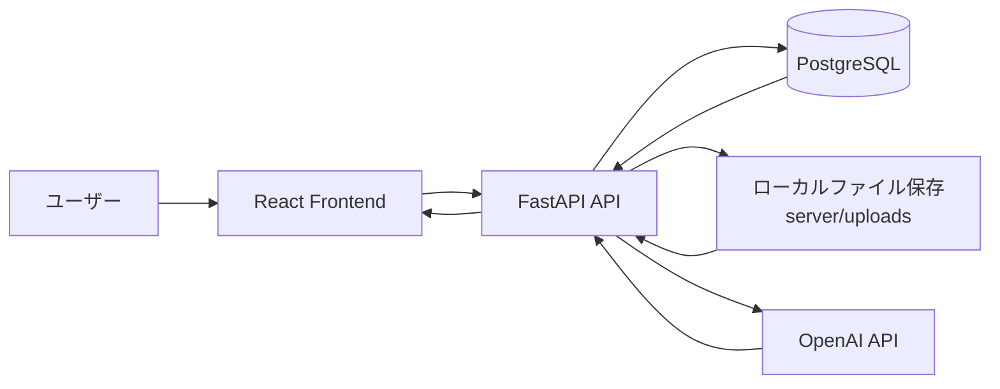
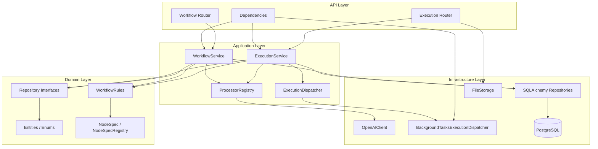
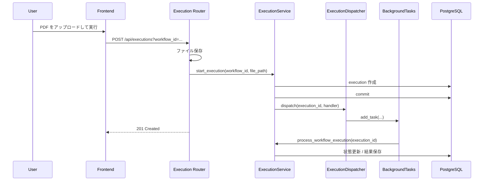

# LayerX Workflow Engine

PDFを入力として、複数ノードからなるワークフローを定義・実行できるドキュメント処理アプリケーションです。  
バックエンドは FastAPI、フロントエンドは React + Vite、永続化には PostgreSQL を利用しています。

## アプリケーション概要

- ワークフローを作成できる
- ワークフローにノードを追加できる
- PDF をアップロードしてワークフローを非同期実行できる
- 実行履歴、実行状態、結果、失敗理由を参照できる
- `EXTRACT_TEXT`、`GENERATIVE_AI`、`FORMATTER` の3種類のノードを利用できる



## 現状の設計

現状はレイヤードアーキテクチャを採用し、`api`、`services`、`domain`、`infra` の責務を分離しています。  
ワークフロー実行の起動方式は `ExecutionDispatcher` で抽象化しており、MVP では `BackgroundTasks` 実装を利用しています。



ワークフロー実行時の流れは以下です。



## ディレクトリ構成

```text
.
├── adr/                    # ADR
├── client/                 # React フロントエンド
├── server/                 # FastAPI バックエンド
├── Claude.md               # 課題実施メモ
└── README.md
```

## 技術スタック

- Backend: FastAPI, SQLAlchemy, Alembic
- Frontend: React, React Router, Vite, TypeScript
- Database: PostgreSQL
- File handling: Python multipart upload + ローカル保存
- PDF parsing: PyPDF2
- AI integration: OpenAI API

## 前提環境

- Python 3.9 以上
- Node.js 18 以上を推奨
- npm
- PostgreSQL

## セットアップ

### 1. PostgreSQL を用意する

ローカルで PostgreSQL を起動し、接続先 DB を作成してください。  
デフォルトでは以下を想定しています。

- DB 名: `layerx_workflow_db`
- ユーザー: `postgres`
- パスワード: `postgres`
- ポート: `5432`

必要に応じて `server/.env` 側で変更してください。

### 2. バックエンドをセットアップする

```bash
cd server
python -m venv .venv
source .venv/bin/activate
pip install -r requirements.txt
cp .env.example .env
```

`.env` の主な項目:

- `DATABASE_URL`
- `DATABASE_URL_SYNC`
- `UPLOAD_DIR`
- `MAX_FILE_SIZE`
- `OPENAI_API_KEY`

補足:

- `OPENAI_API_KEY` は `GENERATIVE_AI` ノードを使う場合に必要です
- `REDIS_URL` は将来拡張用で、現状の MVP 実装では利用していません

### 3. マイグレーションを適用する

```bash
cd server
source .venv/bin/activate
alembic upgrade head
```

### 4. バックエンドを起動する

```bash
cd server
source .venv/bin/activate
uvicorn main:app --reload --host 0.0.0.0 --port 8000
```

起動後のURL:

- API: `http://localhost:8000`
- Swagger UI: `http://localhost:8000/docs`
- Health Check: `http://localhost:8000/health`

### 5. フロントエンドを起動する

```bash
cd client
npm install
npm run dev
```

起動後のURL:

- Frontend: `http://localhost:3000`

## 使い方

1. ワークフローを作成する
2. ワークフロー詳細画面でノードを追加する
3. 必要に応じてワークフローを検証する
4. 実行画面から PDF をアップロードして実行する
5. Execution 一覧または詳細画面で状態と結果を確認する

## 対応ノード

### `EXTRACT_TEXT`

- 入力: PDF ファイル
- 出力: 抽出済みテキスト

### `GENERATIVE_AI`

- 入力: テキスト
- 出力: 生成テキスト
- 主な設定:
  - `prompt`
  - `model`
  - `temperature`
  - `max_tokens`

### `FORMATTER`

- 入力: テキスト
- 出力: 整形済みテキスト
- 主な設定:
  - `format_type`
- 対応フォーマット:
  - `uppercase`
  - `lowercase`
  - `trim`
  - `replace`

## API 一覧

ベースパスは `/api` です。

### Workflow API

- `POST /api/workflows/`
- `GET /api/workflows/`
- `GET /api/workflows/{workflow_id}`
- `POST /api/workflows/{workflow_id}/nodes`
- `GET /api/workflows/{workflow_id}/validate`

### Execution API

- `POST /api/executions/?workflow_id={workflow_id}`
  - `multipart/form-data` で PDF ファイルをアップロード
- `GET /api/executions/`
- `GET /api/executions/{execution_id}`

### Utility API

- `GET /`
- `GET /health`

## 現状の設計上のポイント

- 非同期実行は `BackgroundTasks` を利用した in-process 実装
- 将来のキュー移行に備え、実行起動方式は `ExecutionDispatcher` で抽象化
- ノード処理は `ProcessorRegistry` と各 Processor に分離
- ノードの入出力制約は `NodeSpec` と `WorkflowRules` で管理
- 実行結果と状態は DB に永続化

## ADR

設計判断は `adr/` 配下に記録しています。

- `001-database-selection`
- `002-asynchronous-processing`
- `003-software-architecture`
- `004-node-expansion`
- `005-api-design`
- `006-realtime`

## 補足

- アップロードされたファイルは `server/uploads/` に保存されます
- ログは `server/logs/` に出力されます
- 現在の CORS 設定は `http://localhost:3000` を許可しています
- アプリ起動時に `create_tables()` も呼ばれますが、スキーマ管理は Alembic を正としています
