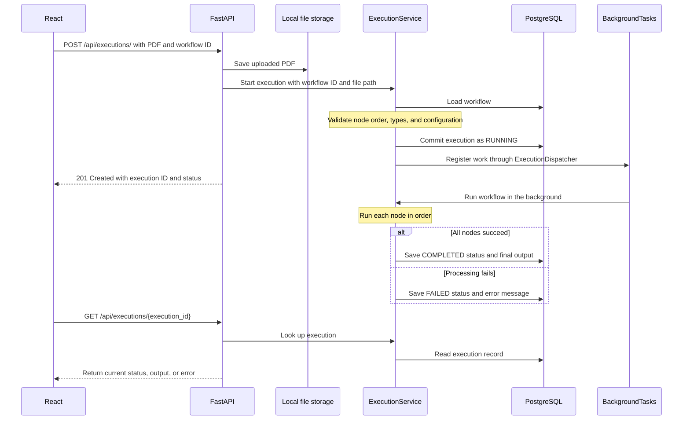

# DocFlow

DocFlow is a document workflow engine that turns uploaded PDFs into text, runs optional AI or formatting steps, and saves the results for later review. The React interface lets you define workflows, submit PDFs, and inspect execution history, results, and errors.

## Features

- Build reusable workflows from PDF extraction, AI generation, and text formatting nodes.
- Validate node order, configuration, and input/output compatibility before running a workflow.
- Upload a PDF and start a background execution.
- Retrieve the status, final output, or error message for a previous execution.

## Software Design

The frontend uses React, TypeScript, and Vite. It calls the FastAPI backend through a shared API client in `client/src/api.ts`. The backend separates HTTP handling, application logic, domain rules, and infrastructure.

| Layer | Responsibility |
| --- | --- |
| `server/api/` | FastAPI routes, request and response schemas, and dependency injection |
| `server/services/` | Workflow creation and validation, execution orchestration, and node processing |
| `server/domain/` | `Workflow`, `Node`, and `Execution` entities, validation rules, node specifications, and repository interfaces |
| `server/infra/` | SQLAlchemy repositories, PostgreSQL models, local file storage, and the OpenAI API client |

The services read and write data through `WorkflowRepository` and `ExecutionRepository`. FastAPI injects the SQLAlchemy implementations, which map between database records and domain entities. The same dependency setup supplies the `ExecutionDispatcher` implementation that schedules background work.

### Node Pipeline

Workflows run as a linear pipeline. Nodes execute in ascending `order`, and each node receives the previous node's output. The first node must accept a PDF. `WorkflowRules` checks that the workflow has at least one node, that order values are unique, and that adjacent data types are compatible.

Node processing uses the Strategy pattern. `ProcessorRegistry` maps each `NodeType` to a processor that validates its configuration and runs the step. `NodeSpecRegistry` defines the input and output types for each node. Adding a node type involves implementing its processor and registering both the processor and its specification. [Node extension design](adr/004-node-expansion.md)

### Execution Lifecycle



PDFs are stored on the local filesystem. PostgreSQL stores workflow definitions, file paths, execution status, final output, and error messages. Reopen or refresh an execution page to fetch its latest status.

FastAPI's `BackgroundTasks` runs work in the API process after the response is sent. If that process stops during an execution, the work is interrupted and the record can remain `RUNNING`. `ExecutionDispatcher` provides an interface for moving job submission to a worker queue in the future. [Background execution design](adr/002-asynchronous-processing.md)

## Supported Nodes

| Node | Input | Output | Configuration |
| --- | --- | --- | --- |
| `EXTRACT_TEXT` | PDF | Extracted text | Uses PyPDF2 to extract text |
| `GENERATIVE_AI` | Text | Generated text | `prompt`, `model`, `temperature`, `max_tokens` |
| `FORMATTER` | Text | Formatted text | `format_type` supports `uppercase`, `lowercase`, `trim`, and `replace` |

## Getting Started

You'll need Python, Node.js with npm, and a running PostgreSQL instance. An OpenAI API key is required when running workflows that use `GENERATIVE_AI`.

### 1. Set up the backend

Create a PostgreSQL database for DocFlow, then run:

```bash
cd server
python -m venv .venv
source .venv/bin/activate
pip install -r requirements.txt
cp .env.example .env
```

Set `DATABASE_URL` and `DATABASE_URL_SYNC` in `server/.env` to point to your database. Set `OPENAI_API_KEY` if you plan to use the AI node.

Apply the Alembic migrations and start the API:

```bash
alembic upgrade head
uvicorn main:app --reload --port 8000
```

The API is available at `http://localhost:8000`. Open Swagger UI at `http://localhost:8000/docs` to explore the endpoints.

### 2. Start the frontend

In a separate terminal, run the following from the repository root:

```bash
cd client
npm install
npm run dev
```

Open `http://localhost:3000`.

### 3. Run a workflow

1. Create a workflow and add `EXTRACT_TEXT` as the first node.
2. Add a `FORMATTER` node with `uppercase`, or add a `GENERATIVE_AI` node with a prompt.
3. Validate the workflow, then upload a PDF from the execution screen.
4. Open the execution details to view the status and output. Refresh the page if the execution is still running.

## API Reference

| Method | Endpoint | Purpose |
| --- | --- | --- |
| `POST` | `/api/workflows/` | Create a workflow |
| `GET` | `/api/workflows/` | List workflows |
| `GET` | `/api/workflows/{workflow_id}` | Get a workflow and its nodes |
| `POST` | `/api/workflows/{workflow_id}/nodes` | Add a node |
| `GET` | `/api/workflows/{workflow_id}/validate` | Validate a workflow |
| `POST` | `/api/executions/?workflow_id={workflow_id}` | Start an execution with a PDF in the `multipart/form-data` field `file` |
| `GET` | `/api/executions/` | List executions |
| `GET` | `/api/executions/{execution_id}` | Get execution status, output, or error |

## Repository Structure

```text
.
├── adr/                    # Architecture decision records
├── client/                 # React, TypeScript, and Vite frontend
│   └── src/                # Screens, API client, and shared types
├── docs/                   # Project documentation and test report
└── server/                 # FastAPI backend
    ├── alembic/            # Database migrations
    ├── api/                # Routes, schemas, and dependency injection
    ├── domain/             # Entities, rules, specs, and repository interfaces
    ├── infra/              # Persistence, file storage, and external API client
    ├── services/           # Workflow and execution logic
    ├── tests/              # Unit and API tests
    └── main.py             # FastAPI entry point
```

## Tests

From the repository root:

```bash
cd server
source .venv/bin/activate
pip install -r requirements-dev.txt
python -m pytest tests/unit/ -v
```

For coverage:

```bash
python -m pytest tests/unit/ --cov=. --cov-report=term-missing
```

See the [test report](docs/test-report.md) for details.
